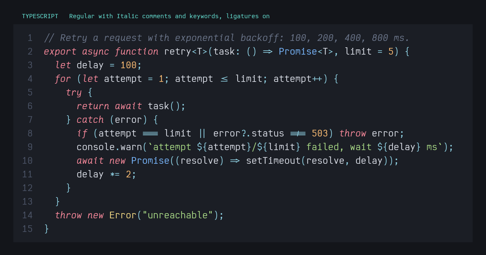
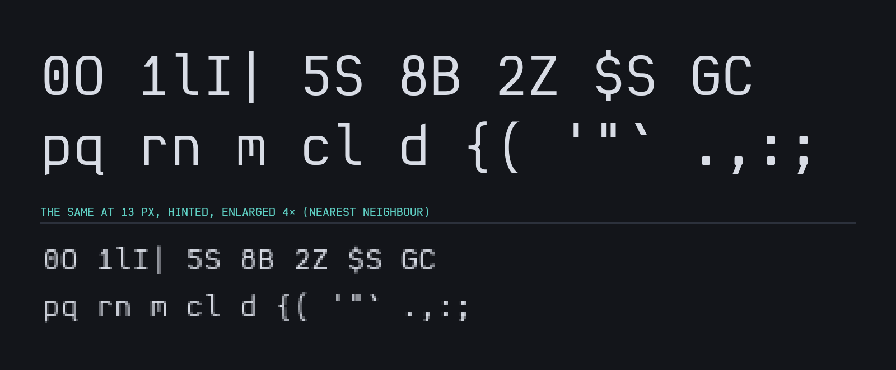
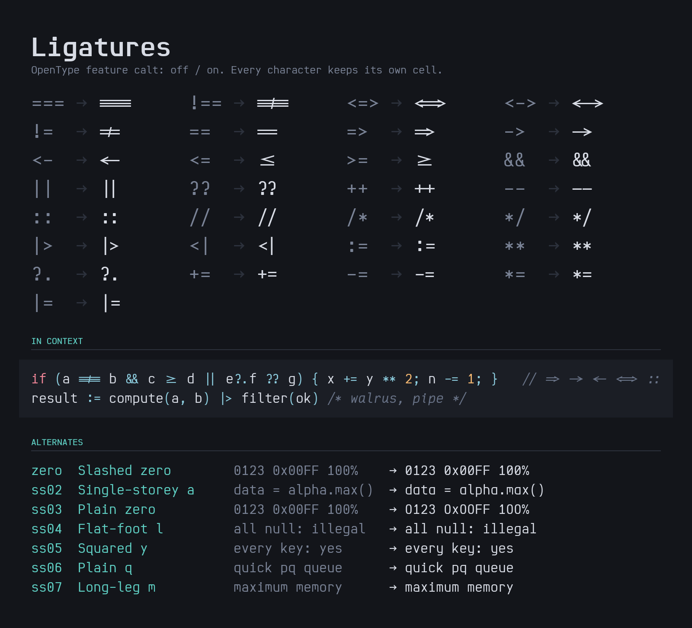
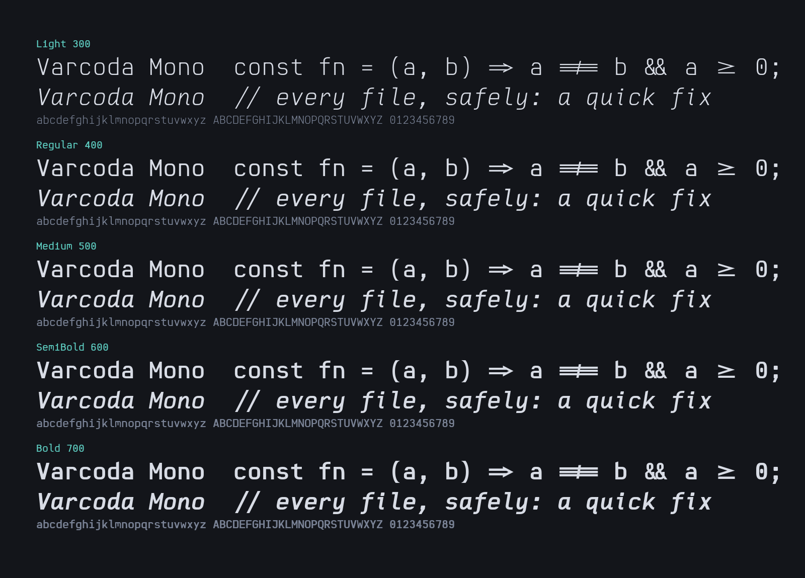

<p align="center">
  
</p>

<h1 align="center">Varcoda Mono</h1>

<p align="center">
  <strong>A squared, technical monospaced typeface for code and terminals.</strong><br>
  Five weights with written italics · 29 ligatures that never shift a column · free and open source
</p>

<p align="center">
  <a href="https://github.com/solomonabraham/Varcoda-Mono/releases/latest"></a>
  <a href="LICENSE"></a>
  <a href="https://github.com/solomonabraham/Varcoda-Mono/actions/workflows/build.yml"></a>
  <a href="https://github.com/solomonabraham/Varcoda-Mono/actions/workflows/validate.yml"></a>
</p>

<p align="center">
  <a href="https://github.com/solomonabraham/Varcoda-Mono/releases/latest"><strong>Download</strong></a> ·
  <a href="#install">Install</a> ·
  <a href="#features">Features</a> ·
  <a href="docs/SPECIMEN.md">Specimen</a> ·
  <a href="docs/INSTALLATION.md">Editor and terminal setup</a>
</p>



Varcoda Mono is a coding font with a character of its own: bowls drawn as rounded rectangles, square dots,
extenders cut at an angle, and an italic that is written rather than slanted. Under the character sits a strict
grid. Every glyph, and every ligature, takes exactly one 600-unit cell per character, so columns, cursors and
selections stay where you expect them.

It is an original design, drawn by a program you can read and measured rather than guessed: look-alike
characters, punctuation sizes and operator alignment are checked by an automated test-suite on every change.

## Download

**[Get the latest release](https://github.com/solomonabraham/Varcoda-Mono/releases/latest)** and take one file.
You do not need to clone this repository to use the font.

| File on the release page | For | Contains |
| --- | --- | --- |
| **`VarcodaMono-<version>.zip`** | **almost everyone** | `ttf/` (install these), `otf/`, `webfonts/`, the licence and a short install guide |
| `VarcodaMono-<version>-web.zip` | websites | the ten WOFF2 files and `varcoda-mono.css` |
| `VarcodaMonoNerdFont-<version>.zip` | terminal prompts with icons | the family patched with the Nerd Fonts icons ([details](docs/NERD-FONTS.md)) |
| `SHA256SUMS` | verifying a download | checksums of the archives |

## Install

1. Unzip `VarcodaMono-<version>.zip` and open its `ttf` folder.
2. Install **all ten files**, so that applications use the real Bold and Italic instead of faking them:

   | System | Steps |
   | --- | --- |
   | **Windows 10/11** | Select the ten files, right-click, **Install**. |
   | **macOS** | Select the ten files, double-click, **Install** in Font Book. Or copy them to `~/Library/Fonts`. |
   | **Linux** | `mkdir -p ~/.local/share/fonts/varcoda-mono && cp ttf/*.ttf ~/.local/share/fonts/varcoda-mono/ && fc-cache -f` |

3. Restart your editor and choose the font family **`Varcoda Mono`**.

**VS Code** (`settings.json`); Cursor, VSCodium and Windsurf take the same settings:

```jsonc
{
  "editor.fontFamily": "'Varcoda Mono', Consolas, 'Courier New', monospace",
  "editor.fontSize": 14,
  "editor.fontLigatures": true,
  "terminal.integrated.fontFamily": "'Varcoda Mono'"
}
```

**Websites:** copy the `webfonts` folder next to your stylesheet.

```html
<link rel="stylesheet" href="webfonts/varcoda-mono.css">
<style>code, pre { font-family: "Varcoda Mono", monospace; }</style>
```

JetBrains IDEs, Zed, Sublime Text, Neovim, Windows Terminal, kitty, WezTerm, Ghostty, Alacritty, iTerm2,
all-users installs, updating and troubleshooting: **[docs/INSTALLATION.md](docs/INSTALLATION.md)**.

## Features

### Characters you cannot mix up



- A **dotted zero** that is neither `O` nor the letter `Ø`. A slashed and a plain zero are one setting away.
- `1`, `l`, `I` and `|` have **four different structures**, not four variations of a stroke.
- `q` ends in a short tail, so it is not the mirror image of `p`; the middle leg of `m` stops short of the
  baseline, so `rn` never reads as `m`.
- `$` and `S`, `G` and `C`, `5` and `S`, `8` and `B`, `2` and `Z`, `{` and `(`, `'` and `` ` `` are compared pair
  by pair by the tests: as outlines, and as hinted bitmaps at 12 to 16 px in every weight.

### Ligatures that keep the grid



```
=== !== <=> <-> != == => -> <- <= >= && || ?? ++ -- :: // /* */ |> <| := ** ?. += -= *= |=
```

- **Optional.** They live in `calt`, the feature behind the ligature switch of editors and terminals. Switched
  off, every operator is the plain character and the font is complete.
- **One cell per character.** A ligature of three characters is three cells wide. Cursor movement, selection
  and column alignment do not change; this is tested with 400 random operator strings per font.
- **Recognisable.** They are the original operators moved together or joined, not new symbols.
- **Restrained.** Long runs such as `====` and `---`, the shifts `<<` `>>` and the ranges `..` `...` stay as typed.

### Five weights, each with a written italic



Light 300, Regular 400, Medium 500, SemiBold 600 and Bold 700. The italic lowercase is drawn, not slanted:
stems leave the baseline to the right, arches branch out of their stem, and `f` descends. It is made for comments
and keywords. Box drawing, arrows and Powerline symbols stay upright in the italic, so a table inside a comment
still lines up.

### Punctuation and operators sized for code

Dots, quotes, the asterisk, parentheses and braces were measured against other coding fonts and enlarged where
they fell short. `+ - = < > ~ | /` and all brackets are centred on one operator axis.

### At home in a terminal

Complete box drawing and block elements that join without seams, and the Powerline separators, are built in.
The full Nerd Fonts icon set is a [separate download](docs/NERD-FONTS.md).

### Your choice of details

| Feature | Effect |
| --- | --- |
| `zero` | slashed zero instead of the dotted one |
| `ss02` | single-storey `a` |
| `ss03` | plain zero |
| `ss04` | `l` with a flat foot |
| `ss05` | squared, hooked `y` |
| `ss06` | plain `q` without the tail |
| `ss07` | `m` with three full legs |

Nothing is on unless you ask for it. What each feature does and why: [docs/FEATURES.md](docs/FEATURES.md).
How to switch them on in your editor: [docs/INSTALLATION.md](docs/INSTALLATION.md#opentype-features-in-your-application).

More pictures, all rendered from the font files in this repository: [docs/SPECIMEN.md](docs/SPECIMEN.md)
(dark and light, code in twelve languages, every glyph, small sizes pixel for pixel, a comparison with
JetBrains Mono, Fira Code and Iosevka).

## Technical specifications

| | |
| --- | --- |
| Styles | Light, Regular, Medium, SemiBold, Bold, each upright and italic: ten static fonts |
| Formats | TTF (TrueType outlines, hinted), OTF (PostScript outlines, hinted), WOFF2 |
| Variable font | not available yet ([why](docs/ROADMAP.md#why-the-open-items-are-open)) |
| Glyphs | 649 glyphs for 579 characters |
| Latin | Basic Latin, Latin-1 Supplement and Latin Extended-A, complete |
| Symbols | box drawing and block elements (complete), Powerline, arrows, mathematical operators, geometric shapes, superscript and subscript figures; of Greek only Δ Λ Π λ π |
| Metrics | 1000 units per em, every advance 600, x-height 540, cap height 720, line height 1.23 em |
| OpenType | `calt`, `zero`, `ss02` to `ss07`, a STAT table; no kerning and no positioning features |
| Italic angle | 9.5° |
| Family name | `Varcoda Mono` (PostScript names `VarcodaMono-Regular`, `VarcodaMono-BoldItalic`, …) |

## Design philosophy

- **Character without confusion.** Personality goes into shapes that also separate letters: the tailed `q`, the
  short-leg `m`, the dotted zero. A detail that costs legibility at 13 px becomes an option, not the default.
- **The grid is not negotiable.** One advance width for everything, no kerning, ligatures that keep their cells.
- **Measured, not guessed.** Changes start with numbers and end with a test. The numbers, including those for
  ideas that were rejected, are in the [quality report](docs/QUALITY_REPORT.md).
- **Nothing acts unless asked.** No feature changes a character behind your back.

The full specification is in [docs/DESIGN.md](docs/DESIGN.md).

## Questions and troubleshooting

**TTF or OTF?** Install the TTF files. The OTF files are the same design with PostScript outlines, for those who
prefer them. Do not install both: they share their names.

**The font does not appear in my editor.** Restart the application; font lists are read at start-up. On Linux run
`fc-cache -f` and check `fc-list "Varcoda Mono"`.

**Bold or italic looks smeared or slanted by force.** Only part of the family is installed. Install all ten files.

**I do not want ligatures,** or **they do not show.** The application decides: `editor.fontLigatures` in VS Code,
*Enable ligatures* in JetBrains IDEs, the `calt` feature in terminals. [Settings for each application](docs/INSTALLATION.md).

**Is there a variable font?** Not yet. 97 of the 649 glyphs still change their point structure between weights,
and a variable font needs them identical. It is on the [roadmap](docs/ROADMAP.md).

**Icons in my prompt show as boxes.** The Powerline separators are built in; the Nerd Fonts icons are not. Use
the Nerd Font download or a symbols-only fallback font: [docs/NERD-FONTS.md](docs/NERD-FONTS.md).

**May I use it at work, in a product, on a website?** Yes. The [SIL Open Font License](LICENSE) allows use,
embedding, modification and redistribution, also commercially. The fonts may not be sold on their own.

More in [docs/INSTALLATION.md](docs/INSTALLATION.md#troubleshooting) and [SUPPORT.md](SUPPORT.md).

## Documentation

| | |
| --- | --- |
| [Installation](docs/INSTALLATION.md) | every system, editor and terminal; OpenType features per application; troubleshooting |
| [Features](docs/FEATURES.md) | ligatures, slashed zero, stylistic sets, and what was left out on purpose |
| [Specimen](docs/SPECIMEN.md) | the pictures |
| [Design](docs/DESIGN.md) | the specification: grid, pens, construction, decisions |
| [Quality report](docs/QUALITY_REPORT.md) | what was checked, how, and with what result |
| [Nerd Fonts](docs/NERD-FONTS.md) | built-in terminal symbols, the patched build, fallback fonts |
| [Building](docs/BUILDING.md) · [Testing](docs/TESTING.md) | from source to font files |
| [Roadmap](docs/ROADMAP.md) · [Changelog](CHANGELOG.md) | what is planned, what changed |

## Building from source

The fonts are generated by a Python program; no font editor is involved. Python 3.10 or later:

```sh
python -m venv .venv && . .venv/bin/activate    # Windows: .venv\Scripts\activate
pip install -r requirements-dev.txt afdko==5.0.1
python scripts/build-fonts.py                   # sources/*.ufo and fonts/{ttf,otf,webfonts}
python -m pytest tests
```

With the pinned packages the build is byte-reproducible; CI rebuilds the fonts and compares them with the
committed files. Details: [docs/BUILDING.md](docs/BUILDING.md).

```
fonts/      the compiled family: ttf/, otf/, webfonts/
sources/    one UFO per style (generated by the build, editable)
scripts/    the drawing program (scripts/fontsrc/) and the build, image and release tools
tests/      the test-suite, validation report, rendering test page, earlier versions for comparison
assets/     pictures used by the documentation    specimens/  the long specimen sheets
docs/       documentation; docs/history/ keeps the audit and the release notes of every version
```

## Known limitations

- **No variable font,** no condensed widths. Latin only: no Cyrillic, and five Greek letters.
- **The italic is sloped by a shear.** Its lowercase is drawn for the italic; capitals, figures and signs are the
  upright forms, sloped.
- **Automatic hinting** (ttfautohint, otfautohint), not hand-tuned.
- **Checked on fewer machines than it deserves.** Built, tested and installed on Windows 11, tested on Linux in
  CI, rendered in Chrome. macOS has not been looked at, and no editor or terminal was driven by a test.
  The [quality report](docs/QUALITY_REPORT.md#not-validated) lists exactly what was and was not checked.

## Contributing and support

Screenshots from real machines are the most useful contribution right now, above all from macOS: open a
*Rendering issue*. Bug reports, glyph requests and pull requests are welcome too. See
[CONTRIBUTING.md](CONTRIBUTING.md), [SUPPORT.md](SUPPORT.md) and the [Code of Conduct](CODE_OF_CONDUCT.md).

If Varcoda Mono earns a place in your editor, a star helps other developers find it, and a screenshot of your
setup tells them more than this page can.

## License

The fonts and their sources are licensed under the [SIL Open Font License 1.1](LICENSE): free to use, embed,
modify and redistribute, also commercially; the fonts may not be sold on their own. No Reserved Font Name is
declared. The build scripts and tests are covered by the same license.

## Acknowledgements

Varcoda Mono is an original design; no outlines were copied from other typefaces. Its squared character is
inspired by [Saira](https://github.com/Omnibus-Type/Saira) by Omnibus-Type, its priorities as a coding font by
JetBrains Mono. Those two, Fira Code and Iosevka were measured and rendered side by side; nothing else was taken
from them. Operator Mono, MonoLisa and Dank Mono were named as references for the direction of the italic and the
ligatures; none of their files was used.

Built with [fontTools](https://github.com/fonttools/fonttools), [ufo2ft](https://github.com/googlefonts/ufo2ft),
[ufoLib2](https://github.com/fonttools/ufoLib2), [skia-pathops](https://github.com/fonttools/skia-pathops),
[ttfautohint](https://freetype.org/ttfautohint/) and [AFDKO](https://github.com/adobe-type-tools/afdko);
tested with [HarfBuzz](https://harfbuzz.github.io/), [FreeType](https://freetype.org/),
[fontbakery](https://github.com/fonttools/fontbakery) and the OpenType Sanitizer.
