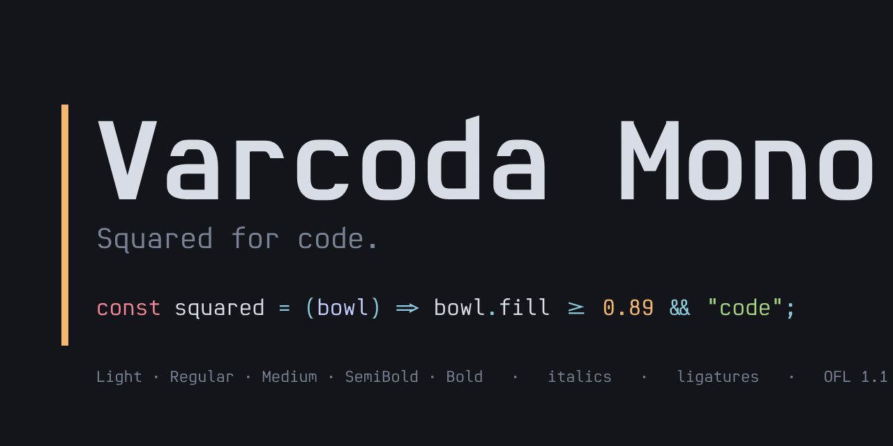

<p align="center"></p>

# Varcoda Mono

A squared, technical monospaced typeface for code and terminals. It takes its direction from the
rounded-rectangle geometry of Saira and the reading comfort of JetBrains Mono, and adds details of its own:
blade-cut extenders, flat shoulders, softened square dots. Every glyph sits on one strict 600-unit cell,
including the ligatures.

Five weights, each with a written italic; 648 glyphs; TTF + OTF + WOFF2; SIL Open Font License 1.1. An original design: other fonts
were measured, never copied.

> **Status: 1.4.0.** Everything listed under *Features* is built into the fonts in this repository and
> covered by the test-suite. A variable font and a Nerd Font build do **not** exist yet (see
> [Known limitations](#known-limitations) and [ROADMAP.md](ROADMAP.md)).
> Formerly "Vector Mono"; see [docs/BRANDING.md](docs/BRANDING.md) for the name and the design direction.

## Features

- **Squared bowls.** `o O 0 a b d e g p q` are rounded rectangles (squareness 0.89, between a classic
  coding font at 0.86 and Saira at 0.91), with square dots and tall ascenders to match.
- **Its own details.** `q` ends in a short tail so it is not the mirror image of `p`; the middle leg of `m`
  stops short of the baseline; the ends of `b d h k t p` are sliced at an angle; arches leave their stems flat,
  without a notch; `D` is squarer than `O`.
- **Strictly monospaced.** Every glyph advances 600 units. No kerning, no positioning features.
- **Characters you cannot mix up.** A dotted `0` that is neither `O` nor `Ø`; `1`, `l`, `I` and `|` all differ in
  structure; `5`/`S`,
  `8`/`B`, `2`/`Z`, `{`/`(` and `'`/`` ` `` are checked against each other at 12–16 px by the tests.
- **Punctuation sized for code.** Dots, quotes, the asterisk, parentheses and braces were measured against
  other coding fonts and enlarged where they fell short ([docs/AUDIT-1.000.md](docs/AUDIT-1.000.md)).
- **One operator axis.** `+ - = < > ~ | /` and all brackets are centred on the same line.
- **28 optional ligatures** that keep one cell per character, so columns and cursors never shift.
- **A slashed zero and six stylistic sets:** single-storey a, plain zero, flat-foot l, squared y, plain q,
  long-leg m.
- **Terminal-ready.** Complete box drawing and block elements that join without seams, plus the Powerline
  separators and symbols.
- **Five weights, ten styles:** Light 300, Regular 400, Medium 500, SemiBold 600, Bold 700, each with an
  italic.
- **A written italic.** The italic lowercase is drawn, not slanted: stems leave the baseline to the right,
  arches branch out of their stem, bowls run back up into it, and `f` descends. Made for comments and keywords;
  box drawing, arrows and Powerline symbols stay upright so tables look the same inside a comment.
- **Dense by default.** Line height 1.23 em, the tightest of the fonts it was compared with.
- **Open build.** Parametric Python sources, editable UFOs, byte-reproducible fonts, 586 automated tests.

## Preview


More: [typography test sheet](assets/test-sheet-dark.png) · [light theme](assets/specimen-light.png) · [weights](assets/weights.png) ·
[all glyphs](assets/glyph-overview.png) · [compared with JetBrains Mono, Fira Code and Iosevka](assets/comparison.png) ·
[before/after 1.000](tests/visual-regression/before-after-dark.png) · [the full specimen](specimens/specimen.png) ·
[code in twelve languages, comments and keywords in the italic](specimens/code-samples.png) · [SPECIMEN.md](SPECIMEN.md)

All images are rendered from the font files in `fonts/` by `scripts/make-assets.py` and
`scripts/make-specimens.py`. None are mock-ups.

## Installation

Download the release ZIP (or use the files in `fonts/`). Use the **TTF** files on Windows; TTF or OTF
elsewhere. Install all ten files so that applications can find Bold and Italic.

| System | Steps |
| --- | --- |
| **Windows 10/11** | Select the ten `.ttf` files in `fonts/`, right-click, **Install** (or *Install for all users*). Restart the applications that should see the font. |
| **macOS** | Double-click the files and press **Install Font** in Font Book, or copy them to `~/Library/Fonts`. |
| **Linux** | `mkdir -p ~/.local/share/fonts/varcoda-mono && cp fonts/*.ttf ~/.local/share/fonts/varcoda-mono/ && fc-cache -f` then check with `fc-list "Varcoda Mono"`. |
| **Web** | Copy `fonts/webfonts/` and include `varcoda-mono.css`; then `font-family: "Varcoda Mono", monospace`. |

For this release the fonts were rendered as web fonts in Chrome on Windows 11; the Linux path (fontconfig,
headless Chromium) was exercised for 1.3.0. Installing into Windows or macOS is the standard procedure for any
font and has not been run here.

## VS Code

```jsonc
// settings.json
{
  "editor.fontFamily": "'Varcoda Mono', Consolas, 'Courier New', monospace",
  "editor.fontSize": 14,
  "editor.fontWeight": "400",            // "500" (Medium) can suit dark themes
  "editor.fontLigatures": true,           // false = no ligatures
  "terminal.integrated.fontFamily": "'Varcoda Mono'"
}
```

To combine ligatures with stylistic sets, give `editor.fontLigatures` a feature string instead of `true`:

```jsonc
"editor.fontLigatures": "'calt', 'zero'"      // ligatures + slashed zero
"editor.fontLigatures": "'calt' off, 'ss04'"  // no ligatures, flat-foot l
```

## Terminals and other editors

**Windows Terminal** (`settings.json`). Windows Terminal applies `calt` by default; set it to `0` to turn
ligatures off.

```jsonc
"profiles": { "defaults": { "font": {
  "face": "Varcoda Mono", "size": 11, "weight": "normal",
  "features": { "calt": 1, "zero": 0 }
} } }
```

**PowerShell** has no font setting of its own: it uses the font of the window it runs in. In Windows
Terminal use the block above. In the classic console window, open *Properties → Font* and choose
*Varcoda Mono* (that console does not render ligatures).

**JetBrains IDEs:** *Settings → Editor → Font*, choose *Varcoda Mono*, tick *Enable ligatures* if wanted.

**kitty** (`kitty.conf`):

```conf
font_family      Varcoda Mono
disable_ligatures never            # or: always
font_features    VarcodaMono-Regular +zero
```

**WezTerm** (`wezterm.lua`):

```lua
config.font = wezterm.font('Varcoda Mono', { weight = 'Regular' })
config.harfbuzz_features = { 'calt=1', 'zero=0' }
```

**Alacritty** and other terminals without OpenType shaping show the plain operators; nothing breaks.

**Nerd Font icons.** The Powerline symbols (U+E0A0–E0A2, U+E0B0–E0B3) are built in. For the full icon set
use a symbols-only fallback font next to Varcoda Mono; a patched "Varcoda Mono Nerd Font" is not provided yet.
Details and the untested patching recipe are in [docs/NERD-FONTS.md](docs/NERD-FONTS.md).

## Ligatures


```
=== !== <=> <-> != == => -> <- <= >= && || ?? ++ -- :: // /* */ |> <| := ** ?. += -= *=
```

- They live in `calt`, the feature that editor and terminal ligature switches control. With it off, the font
  is complete and every operator is the plain glyph.
- A ligature of *n* characters is still *n* glyphs of 600 units, so selection, cursor movement and column
  alignment are unaffected. This is tested with 400 random operator strings per font.
- Longer runs are left alone: `====`, `---`, `///`, `:::`, `>>=`, `-->` stay plain.

## Slashed zero and stylistic sets

| Tag | Effect | Why you might want it |
| --- | --- | --- |
| `zero` | slashed zero instead of the dotted one | the classic coding zero; leave it off if you read or write `Ø` |
| `ss02` | single-storey `a` (and its accented forms) | a more geometric texture |
| `ss03` | plain zero | for prose or data where the dot distracts; `0` and `O` then differ only in width |
| `ss04` | `l` with a flat foot instead of the curved tail | closer to a typewriter `l` (plain `l` only, not `ĺ ľ ļ ŀ ł`) |
| `ss05` | squared `y`: built like `u` with a hooked descender (also `ý ÿ ŷ`) | the most Saira-like form; opt-in because at 12–14 px it is closer to `g` and `u` than the default |
| `ss06` | plain `q`: the mirror image of `p`, without the tail | a more conventional `q` |
| `ss07` | `m` with all three legs on the baseline | a more conventional `m` |

The sets suggested during planning for `I`, `g`, punctuation size, braces and operators were not added:
no alternative for them improved on the default in the measurements, and an empty or cosmetic set would
only clutter font menus. `cvNN` duplicates of the six sets were left out for the same reason.

`ss01` selected the dotted zero until 1.3.0. That zero is now the default, so the set is retired: a setting
that still turns it on is ignored and shows the same zero as before. The number will not be reused.

## Building from source

Short version below; details in [BUILD.md](BUILD.md) and [TESTING.md](TESTING.md). Every OpenType feature
is documented with examples in [FEATURES.md](FEATURES.md), the design in [DESIGN.md](DESIGN.md).

Requires Python 3.10 or later (developed and tested with 3.13).

```sh
python -m venv .venv && . .venv/bin/activate
pip install -r requirements-dev.txt        # build + test dependencies
python scripts/build-fonts.py              # sources/*.ufo, fonts/*.ttf, fonts/otf, fonts/webfonts
python -m pytest tests                     # 586 tests
python tests/font-validation/validate.py   # optional: fontbakery + ufolint report
python scripts/make-assets.py              # images in assets/
python scripts/make-release.py             # releases/VarcodaMono-1.4.0.zip
```

The design lives in `scripts/fontsrc/`: `params.py` holds the grid and the pens of each weight, the
`glyphs_*.py` modules draw the glyphs (`glyphs_italic.py` holds the written italic lowercase). Change a number, rebuild, and all ten styles follow. The UFOs in
`sources/` are regenerated on each build; to compile hand-edited UFOs instead use
`python scripts/build-fonts.py --from-ufo`. Two builds of the same sources on one machine are byte-identical.

Other tools: `scripts/compare-fonts.py` (measure any fonts side by side), `scripts/check-interpolation.py`
(variable-font readiness), `scripts/make-regression.py` (before/after renders),
`scripts/rename-family.py` (rename the family everywhere).

## Repository structure

```
assets/                  images used by the documentation (generated)
docs/                    naming and identity, comparison method, Nerd Fonts, release notes, earlier audits
fonts/                   VarcodaMono-*.ttf, otf/*.otf, webfonts/*.woff2 + varcoda-mono.css
sources/                 VarcodaMono-*.ufo (UFO 3, generated, editable)
scripts/fontsrc/         the parametric design: params, geometry kit, glyph modules, build
scripts/*.py             build, assets, release, measurement and maintenance tools
tests/font-validation/   pytest suite for the binaries and sources; fontbakery report
tests/rendering-tests/   hinted small-size rendering tests, Chromium tests, manual test page
tests/visual-regression/ before/after renders against 1.000, ink-density table
tests/baseline/          the 1.000 fonts and the 1.300 italic, kept for comparison
.github/                 issue and pull-request templates, CI workflows
```

## Known limitations

- **The italic is sloped by a shear.** The lowercase is drawn for the italic, but the slant itself is applied
  by the build, so curve weights are not optically corrected (the error is below 3 % of the stem), and capitals,
  figures and signs are the upright forms, sloped. The tops of wide capitals lean up to 52 units over the right
  cell edge; a terminal that clips every cell may shave about half a pixel.
- **No variable font.** The weights are static files. 551 of 648 glyphs are interpolation-compatible;
  the remaining 97 change their point structure between weights.
- **No Nerd Font build.** Only the seven core Powerline glyphs are included.
- **No editor or terminal was driven.** 1.4.0 was built, tested and validated on Windows 11 (FreeType, HarfBuzz)
  and rendered in Chrome there, which shares its text stack with VS Code and Cursor. VS Code, Windows Terminal,
  PowerShell and JetBrains IDEs themselves were not run, and macOS has **not** been looked at.
  `tests/rendering-tests/index.html` is a self-contained page for checking a real machine.
- **Automatic hinting.** ttfautohint and otfautohint, no hand-tuned hints.
- **Latin only.** Basic Latin, Latin-1 and Latin Extended-A are complete; Greek is limited to Δ Λ Π λ π;
  there is no Cyrillic. Accents are precomposed; there are no combining marks.
- **Capital rhythm** is slightly less even than in the fonts it was compared with; the capitals stay wide
  to keep `8`/`B` and `0`/`O` apart at small sizes.
- **The CI workflows have never run.** They were written and syntax-checked locally.
- **Name clearance is incomplete.** See [docs/BRANDING.md](docs/BRANDING.md).

## Roadmap

1.4.0 is this release. Next: checks in real editors and terminals on Windows and macOS (1.4.x),
interpolation-compatible outlines and a variable font (1.5), a Nerd Font build (1.6). Details, and what
"planned" means, are in [ROADMAP.md](ROADMAP.md).

## Contributing

Bug reports with screenshots from real machines are the most useful contribution right now, above all
from Windows and macOS. See [CONTRIBUTING.md](CONTRIBUTING.md), [SUPPORT.md](SUPPORT.md) and the
[Code of Conduct](CODE_OF_CONDUCT.md).

## License

The fonts and their sources are licensed under the [SIL Open Font License 1.1](LICENSE): free to use,
embed, modify and redistribute, also commercially; the fonts may not be sold on their own. No Reserved
Font Name is declared. The build scripts and tests are covered by the same license.

## Acknowledgements

Varcoda Mono is an original design; no outlines were copied from other typefaces. Its squared character
is inspired by [Saira](https://github.com/Omnibus-Type/Saira) by Omnibus-Type, its priorities as a coding font
by JetBrains Mono. Those two, Fira Code and Iosevka were measured and rendered side by side; nothing else
was taken from them. The brief for 1.4.0 named Operator Mono, MonoLisa and Dank Mono as references for the
direction of the italic, of readability and of the ligatures; none of their files was used.

Built with [fontTools](https://github.com/fonttools/fonttools), [ufo2ft](https://github.com/googlefonts/ufo2ft),
[ufoLib2](https://github.com/fonttools/ufoLib2), [skia-pathops](https://github.com/fonttools/skia-pathops),
[ttfautohint](https://freetype.org/ttfautohint/) and [AFDKO](https://github.com/adobe-type-tools/afdko);
tested with [HarfBuzz](https://harfbuzz.github.io/), [FreeType](https://freetype.org/),
[fontbakery](https://github.com/fonttools/fontbakery) and the OpenType Sanitizer.
