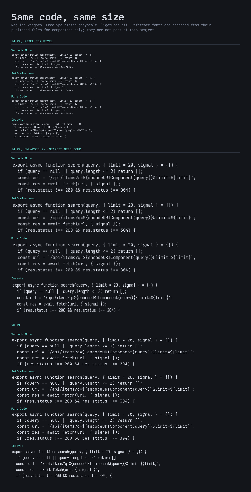
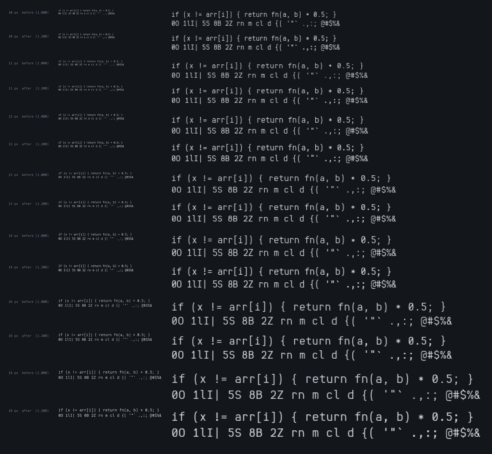

# Specimen

All images are generated from the fonts in `fonts/` by `python scripts/make-assets.py`.

## Dark and light

## Weights

## Ligatures and stylistic sets

## Glyph overview

## Next to other coding fonts

JetBrains Mono, Fira Code and Iosevka are rendered from their published files for comparison only. They
are separate projects under their own licenses and are not distributed here. Method: `docs/COMPARISON.md`.

## Before and after 1.000

## In your own environment

Open `tests/rendering-tests/index.html` in a browser: a self-contained page (the fonts are embedded) with
waterfalls, look-alike rows, ligature toggles and box drawing. `specimens/` holds the two long-form sheets
from 1.000, regenerated with the current fonts (`python scripts/make-specimens.py`).
