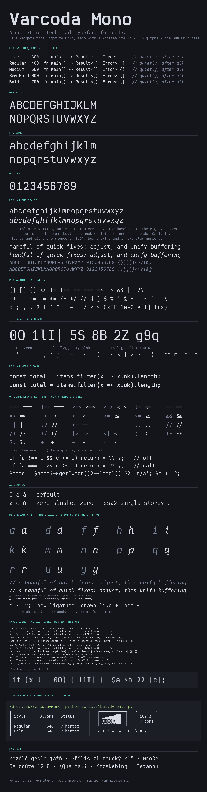
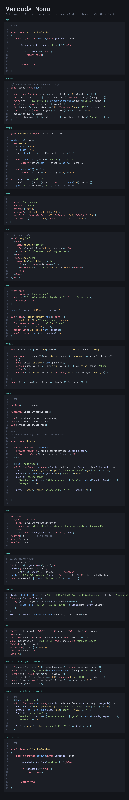
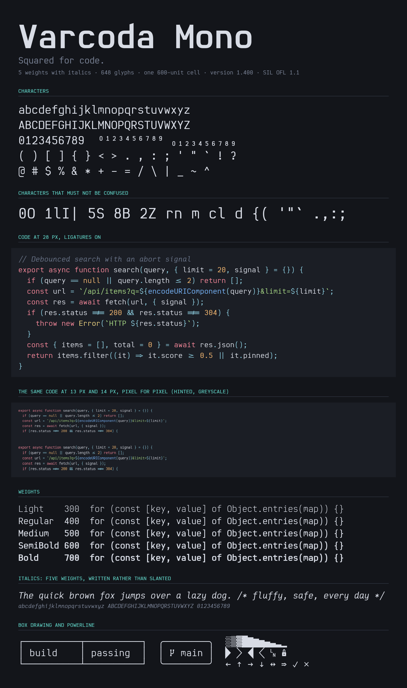
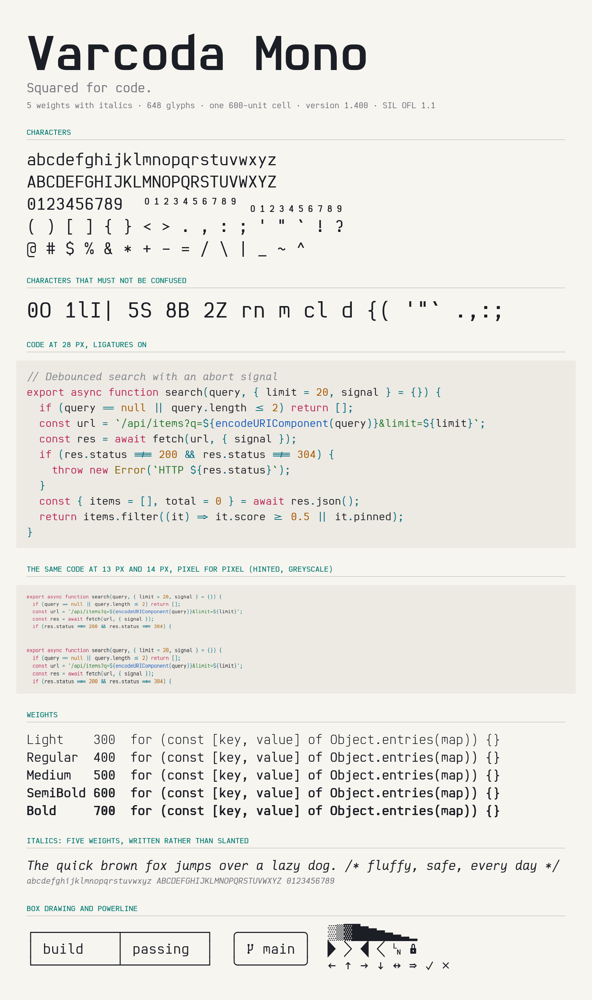
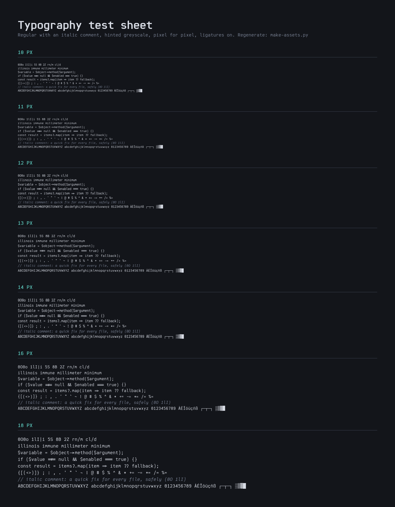
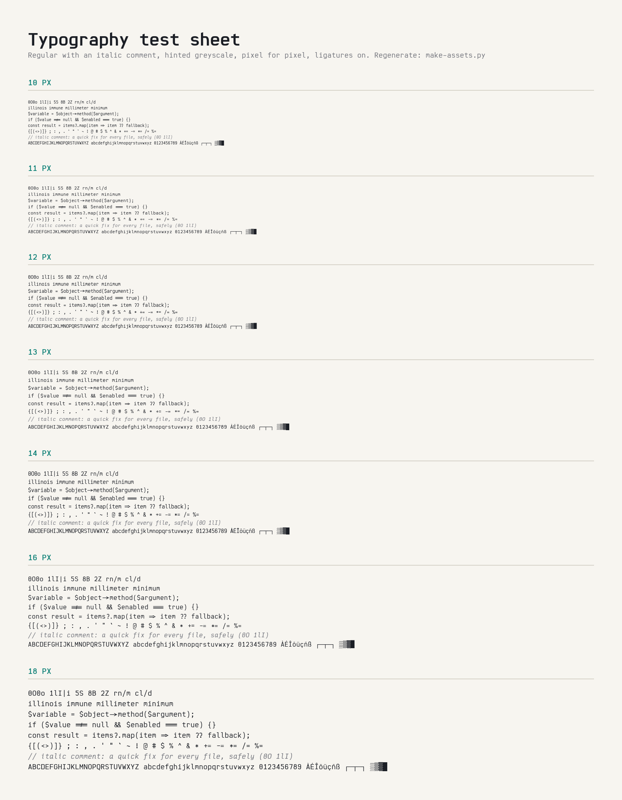
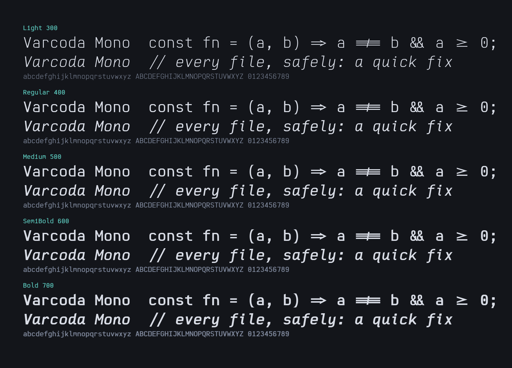
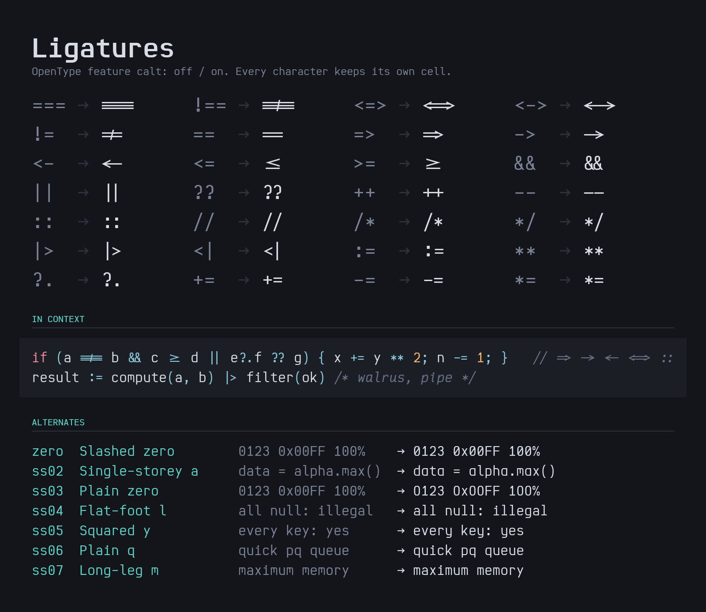
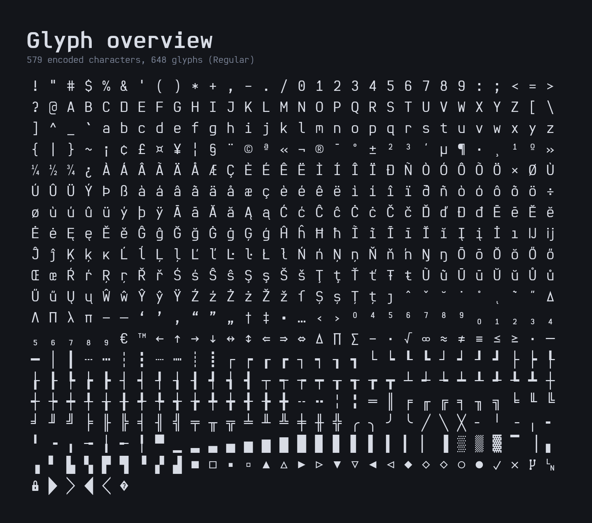

# Specimen

All images are generated from the fonts in `fonts/` by `python scripts/make-assets.py` and
`python scripts/make-specimens.py`.

## The full specimen

Alphabets, Regular and Italic side by side, every ligature off and on, the italic before and after 1.4.0,
small sizes, box drawing.

## Code in twelve languages

Comments and keywords are set in the italic, the way an editor theme sets them; both styles share one grid.

## Dark and light

## Typography test sheet

The same lines at 10, 11, 12, 13, 14, 16 and 18 px, pixel for pixel, with an italic comment.

## Weights and italics

## Ligatures and stylistic sets

## Glyph overview

## Next to other coding fonts

JetBrains Mono, Fira Code and Iosevka are rendered from their published files for comparison only. They
are separate projects under their own licenses and are not distributed here. Method: `docs/COMPARISON.md`.

## Before and after 1.000

## In your own environment

Open `tests/rendering-tests/index.html` in a browser: a self-contained page (the fonts are embedded) with
waterfalls, look-alike rows, ligature toggles and box drawing. `specimens/code-samples.png` sets twelve languages
(PHP, Drupal, JavaScript, TypeScript, Python, JSON, YAML, HTML, CSS, SQL, Bash, PowerShell); both sheets in `specimens/` are regenerated with the current fonts (`python scripts/make-specimens.py`).
