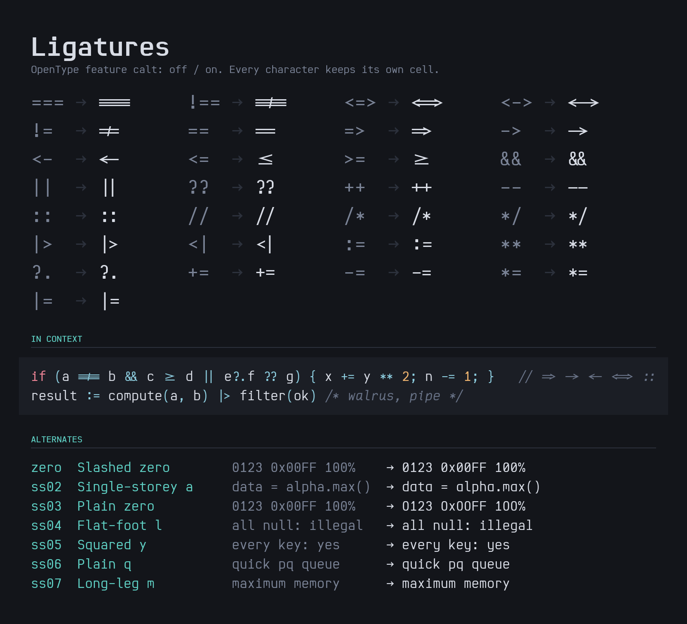

# OpenType features

What the features of Varcoda Mono do, and why they are the way they are. How to switch them on in an editor or
terminal is in [INSTALLATION.md](INSTALLATION.md#opentype-features-in-your-application).

Everything here is in the compiled fonts and covered by tests (`TESTING.md`). Nothing is on by default
except what the application itself enables (most editors and terminals enable `calt`).



## Summary

| Feature | What it does | Default |
| --- | --- | --- |
| `calt` | 29 programming ligatures | controlled by the application's "ligatures" switch |
| `zero` | slashed zero (the default zero is dotted) | off |
| `ss02` | single-storey `a` (and `à á â ã ä å ā ă ą`) | off |
| `ss03` | plain zero | off |
| `ss04` | `l` with a flat foot | off |
| `ss05` | squared, hooked `y` (and `ý ÿ ŷ`) | off |
| `ss06` | plain `q`, the mirror image of `p` (the default `q` has a tail) | off |
| `ss07` | `m` with three full legs (the default `m` has a short middle leg) | off |

There is no `liga`, `kern` or `cvNN` feature and no GPOS table. See "What is deliberately missing".

## Ligatures (`calt`)

```
=== !== <=> <-> != == => -> <- <= >= && || ?? ++ -- :: // /* */ |> <| := ** ?. += -= *= |=
```

- **The text never changes.** Ligatures are drawn by substituting glyphs; copy, search and the file on disk
  see the original characters.
- **The grid never changes.** A ligature of *n* characters is *n* glyphs of 600 units: the first *n − 1* are
  empty spacers, the last one carries the drawing, which reaches back over the spacers.
- **Recognisable.** They are the original operators moved closer or joined, not new symbols. `!=` is an
  equals sign with a stroke, `=>` an arrow with a double shaft, `:=` lifts the colon to the level of the bars.
- **Not stretched.** `<=` and `>=` are compact signs, 720 units wide in their two cells of 1200, with white
  space on both sides. Stretched over both cells the chevron opened by only 17° and no longer read as `<`;
  now it opens by 33°.
- **Longer runs are left alone:** `====`, `---`, `///`, `:::`, `>>=`, `-->`.
- **Shifts and ranges stay plain:** `<<` `>>` `<<=` `>>=` `..` `...` have no ligature, and `<=` `>=` never form
  inside the shifts.
- **Longer operators keep their first ligature:** `**=` is `**` and a plain `=`, `??=` is `??` and `=`, `||=` is `||` and `=`, and the
  nullsafe `?->` is `?` followed by the arrow.
- **Why `calt` and not `liga`:** `calt` can look at context (needed to leave long runs alone), and it is the
  feature that editor and terminal ligature switches control. With `calt` off the font is complete.

## Slashed zero and stylistic sets

| Feature | Plain | With the feature | Use it when |
| --- | --- | --- | --- |
| `zero` | dotted `0` | slashed `0` | you prefer the classic slashed zero and never meet the letter `Ø` |
| `ss02` | double-storey `a` | single-storey `a` | you want a more geometric texture (it is always single-storey in the italics) |
| `ss03` | dotted `0` | plain `0` | prose or data where the mark distracts; `0` and `O` then differ only in width |
| `ss04` | `l` with a curved tail | `l` with a flat foot | you prefer a typewriter `l` |
| `ss05` | diagonal `y` | squared, hooked `y` | you want the most Saira-like form (closer to `g` and `u` at 12–14 px) |
| `ss06` | tailed `q` | plain `q` | you prefer the conventional `q` |
| `ss07` | short-leg `m` | full `m` | you prefer the conventional `m` |

`zero` and `ss03` both replace the zero; if both are on, `zero` wins.

`ss01` selected the dotted zero until 1.3.0. That zero is now the default, so the set is retired: a setting
that still turns it on is ignored and shows the same zero as before. The number will not be reused.

## Italics and features

All features work the same in the italic styles. In the italics `a` is already single-storey and `y` is
already the hooked form, so `ss02` and `ss05` change nothing there. `ss06` and `ss07` give the plain `q` and the
long-leg `m` in their written forms; `ss04` gives the flat-foot `l`.

The italic lowercase is written rather than slanted (`DESIGN.md` §13). No feature switches it back to a slanted
roman: an application that wants an oblique can slant the upright itself.

## What is deliberately missing

| Not there | Why |
| --- | --- |
| `cvNN` character variants | they would duplicate the six sets one-to-one; sets are supported by more applications |
| `ss08` | no eighth alternate improved on a default in testing; an empty set would only clutter font menus |
| `ss01` | it was the dotted zero, which is the default since 1.3.0; the number stays empty so that an old setting cannot select something else |
| A double-storey `g` | the single-storey `g` matches the squared bowls; a double-storey `g` needs two counters in a 600-unit cell and closes up in the heavier weights |
| Ligatures for `/=` `%=` `&=` `^=` | measured: the two signs already stand as close as those of `+=` (108–179 units apart, `+=` 162), and the slash, the per cent sign and the ampersand leave no room to move. Only `\|=` was loose (340 units) and got its ligature in 1.5.0 |
| Ligatures for `<<` `>>` `..` `...` | the chevrons are 159 units apart as they are; periods on the grid are what a range or an ellipsis is in monospaced text |
| `salt` | it would turn all six alternates on together; the sets select each one |
| `tnum` | every figure already has the one advance, so the feature would be empty |
| `locl` | tried for Romanian (`Ş Ţ` to `Ș Ț`, which are in the font) and removed: `locl` is always on, and nothing in these fonts acts without being asked. Type the comma-below letters directly |
| Kerning (`kern`, GPOS) | a monospaced font must not move glyphs |
| Texture healing | evaluated and declined: `DESIGN.md` §14 |
