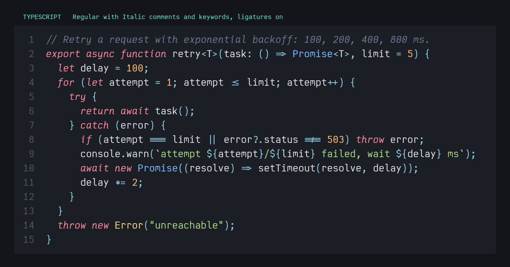
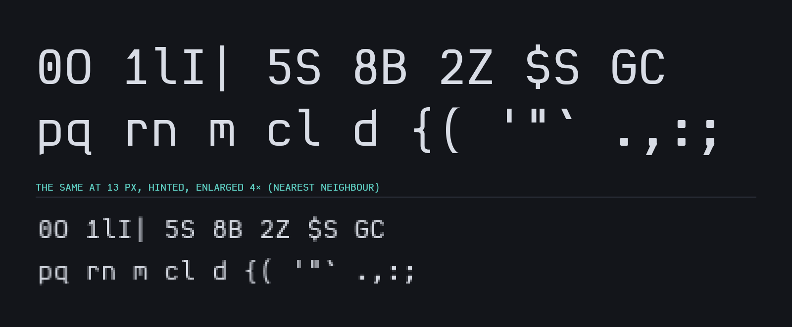
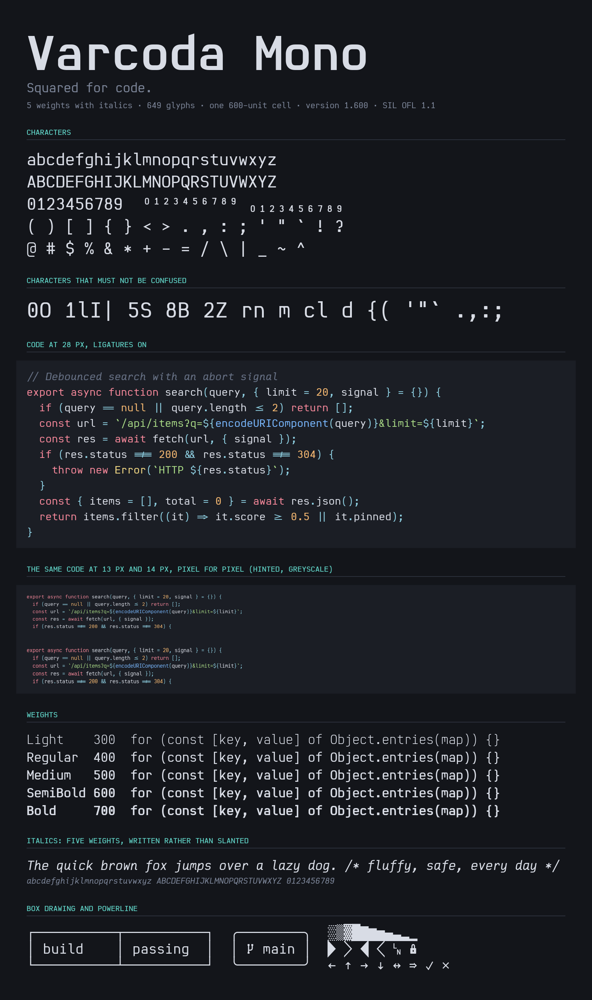
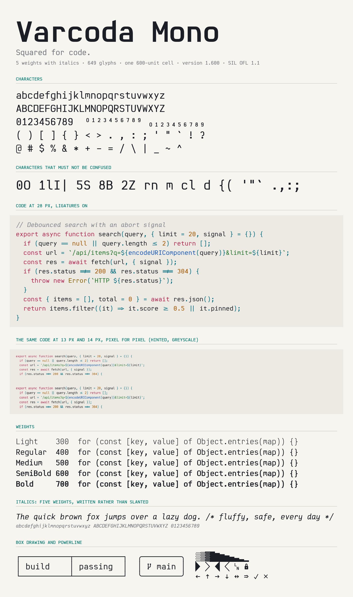
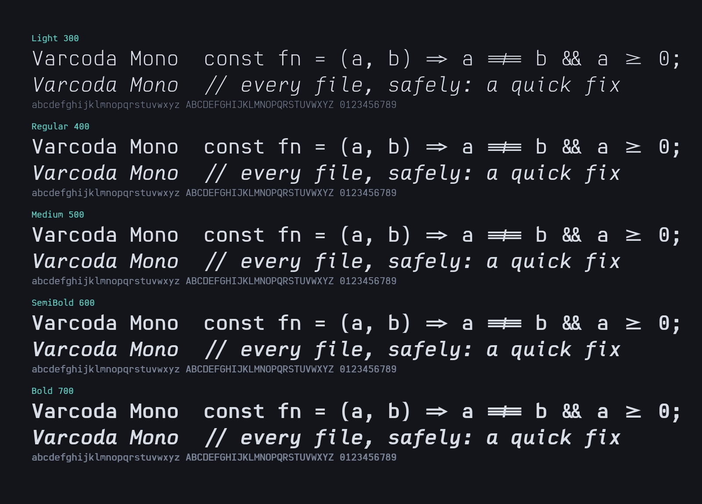
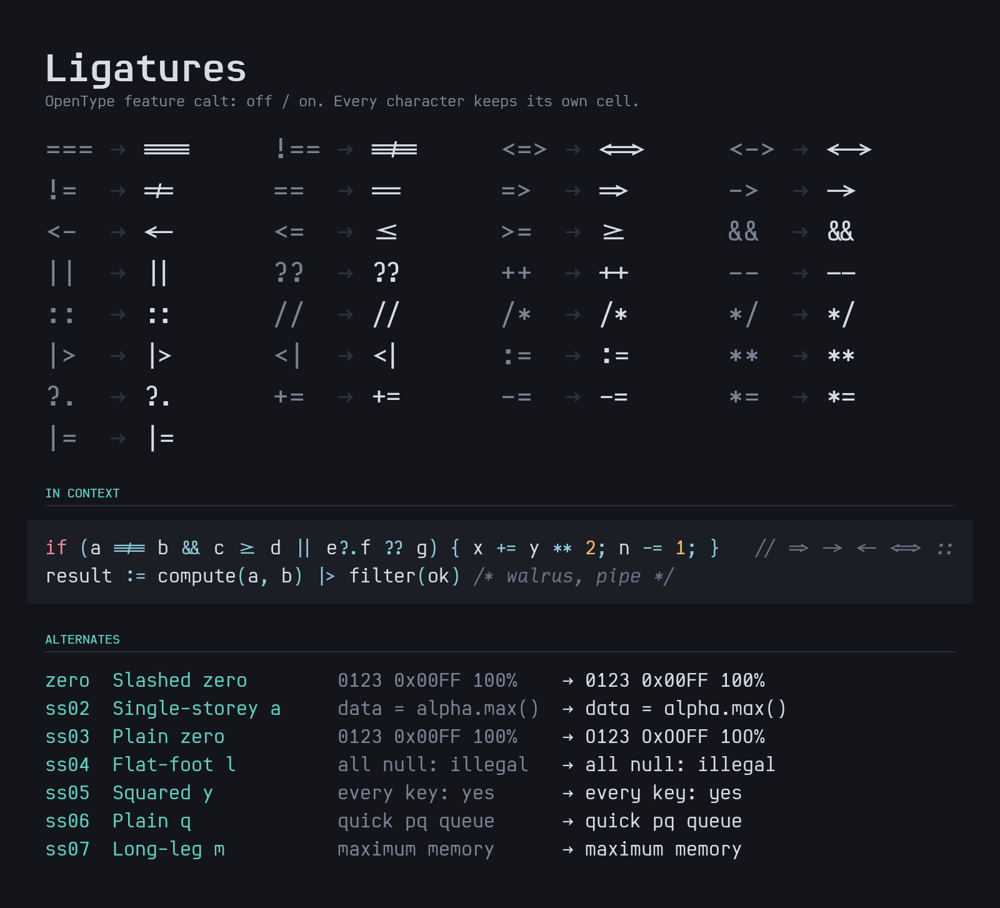
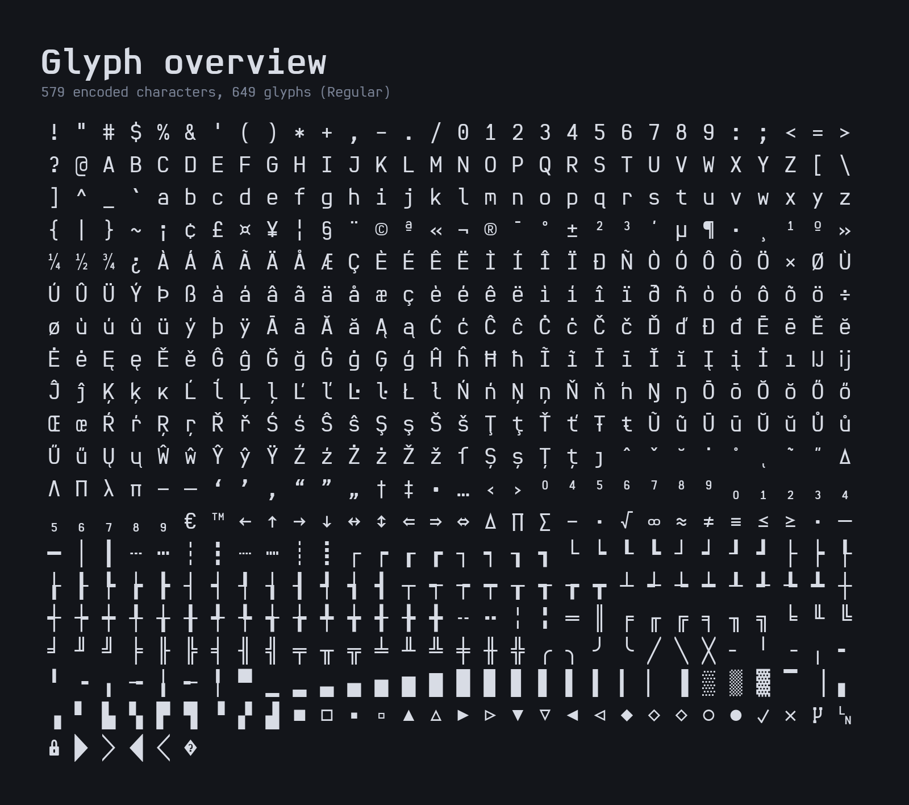
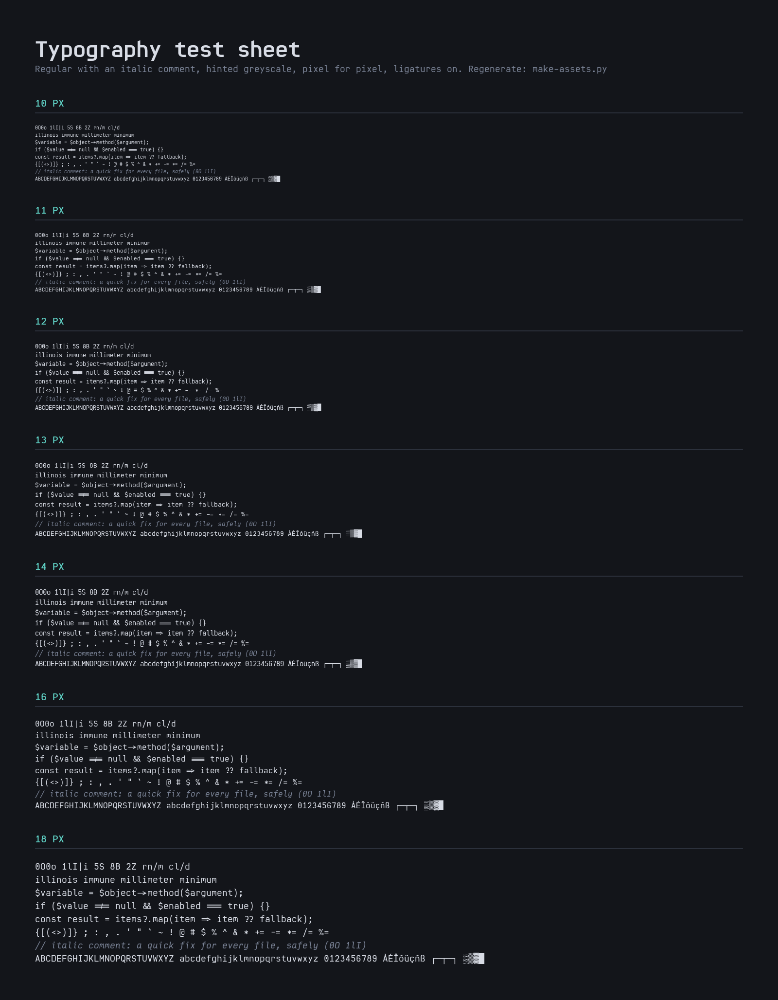
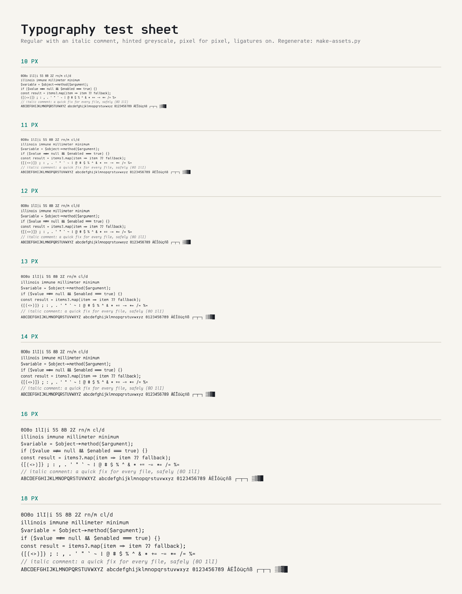
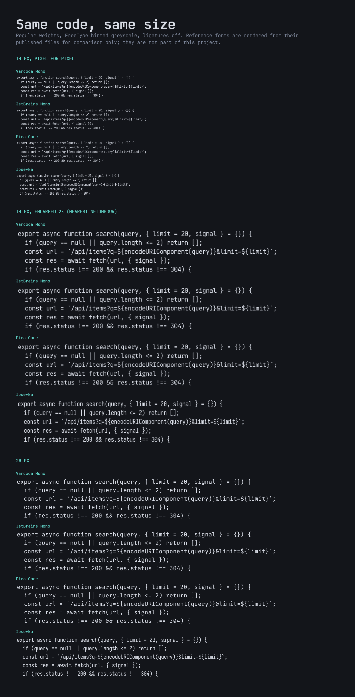

# Specimen

Every picture here is rendered from the font files in `fonts/ttf/` by `scripts/make-assets.py` and
`scripts/make-specimens.py`: HarfBuzz shapes the text, FreeType draws it with the fonts' own hinting, at whole
pixel sizes. None is a mock-up. They show what a Linux desktop shows; Windows and macOS draw slightly different
pixels from the same outlines.

## Code

Comments and keywords are set in the italic, the way an editor theme sets them. Both styles share one grid.

## Characters that must not be confused

## The family at a glance

## Weights and italics

## Ligatures and stylistic sets

## Every character

## Small sizes, pixel for pixel

The same lines at 10, 11, 12, 13, 14, 16 and 18 px, with an italic comment.

## Next to other coding fonts

JetBrains Mono, Fira Code and Iosevka are rendered from their published files for comparison only. They are
separate projects under their own licenses and are not distributed here. Method: [COMPARISON.md](COMPARISON.md).

## The long sheets

| Sheet | Shows |
| --- | --- |
| [The full specimen](../specimens/specimen.png) | alphabets, Regular and Italic side by side, every ligature off and on, the italic before and after 1.4.0, small sizes, box drawing |
| [Code in twelve languages](../specimens/code-samples.png) | PHP, Drupal, JavaScript, TypeScript, Python, JSON, YAML, HTML, CSS, SQL, Bash, PowerShell |
| [Before and after 1.000](../tests/visual-regression/before-after-dark.png) | the first version against the current one, at seven sizes |
| [1.5.0 against 1.6.0](../tests/visual-regression/compare-previous-dark.png) | the previous release against this one: the confusable matrix, operators, PHP/Drupal, TypeScript, Python and regular expressions, all ten styles. [`testbench.html`](../tests/visual-regression/testbench.html) shows the same in a browser |

## In your own environment

`tests/rendering-tests/index.html` is a self-contained page (the fonts are embedded) with waterfalls, look-alike
rows, ligature toggles and box drawing. Open it in a browser to see how your own machine draws the family.
